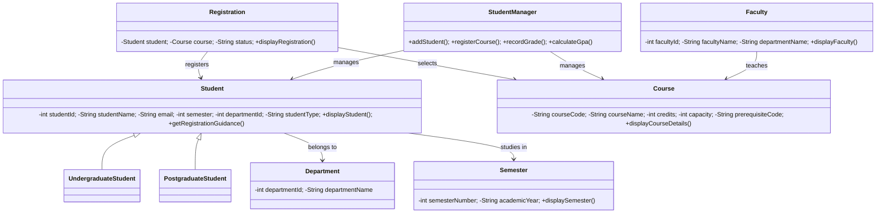
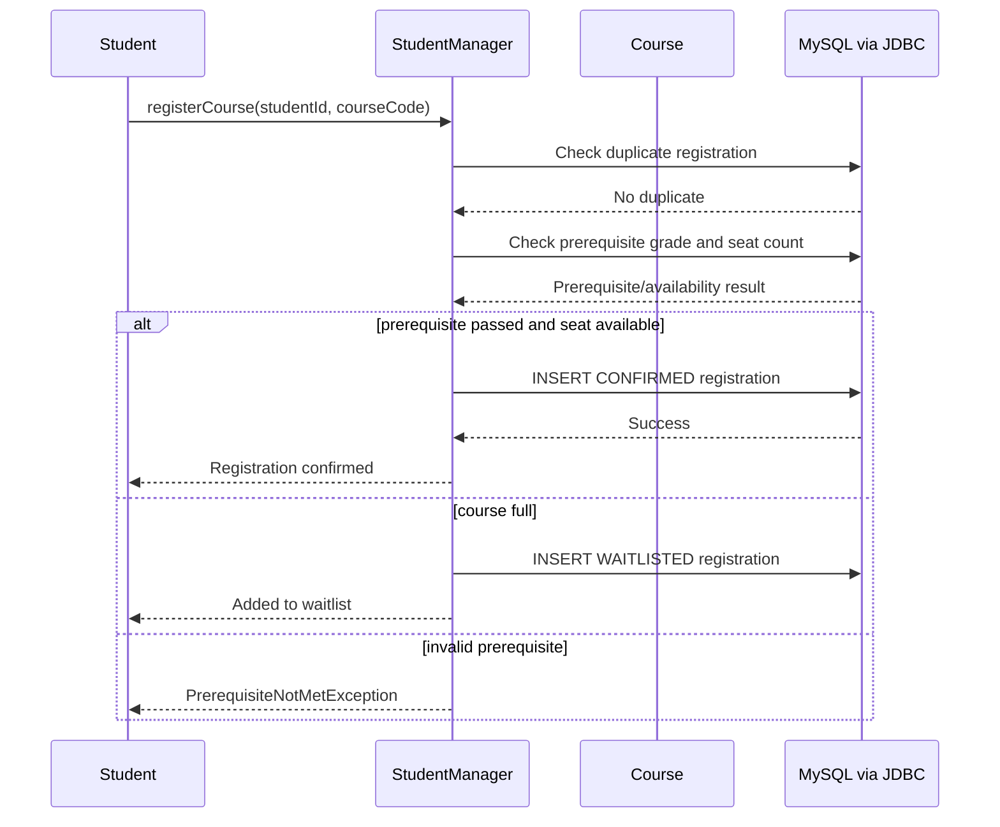

# Case Study 1 — Analysis and Design

## Part A — Analysis

### 1. Objects
- Student S1
- Course C1
- Faculty F1
- Registration R1
- Department D1
- Semester Sem1

### 2. Classes
`Student`, `Course`, `Faculty`, `Registration`, `Department`, and `Semester` represent the objects above.

### 3. Attributes
- **Student:** `studentId`, `studentName`, `email`, `semester`, `departmentId`, `studentType`
- **Course:** `courseCode`, `courseName`, `credits`, `capacity`, `prerequisiteCode`
- **Faculty:** `facultyId`, `facultyName`, `departmentName`
- **Registration:** `student`, `course`, `status`
- **Department:** `departmentId`, `departmentName`
- **Semester:** `semesterNumber`, `academicYear`

### 4. Behaviors
- **Student:** `displayStudent()`, `getRegistrationGuidance()`
- **Course:** `displayCourseDetails()`
- **Faculty:** `displayFaculty()`
- **Registration:** `displayRegistration()`
- **Department:** getters and `setDepartmentName()`
- **Semester:** `displaySemester()`
- **StudentManager:** `addStudent()`, `loadStudents()`, `loadCourses()`, `registerCourse()`, `recordGrade()`, `calculateGpa()`, `displayRegistrations()`

### 5. Message passing
1. Student requests registration by entering student ID and course code.
2. `Main` sends the request to `StudentManager.registerCourse()`.
3. `StudentManager` checks Student and Course objects stored in maps.
4. It queries MySQL through JDBC to check duplicate enrollment, prerequisite grades, and course capacity.
5. If valid, it inserts a confirmed registration; if the course is full, it stores a waitlisted registration and adds the ID to a `Queue<Integer>`.
6. `Main` prints the confirmation or a custom exception message.

## Part B — Design

### Class diagram

### Object interaction diagram

